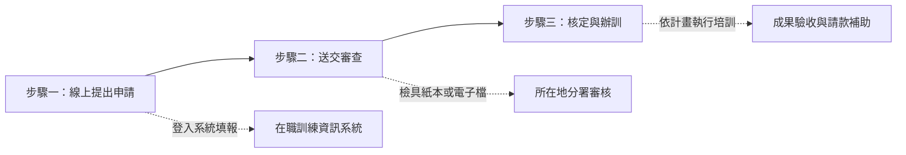

# 《企業人力資源提升計畫》重點摘要報告

> **資料來源**：勞動部勞動力發展署《企業人力資源提升計畫_懶人包.pdf》  
> **核心宗旨**：強化在職人力素質，提升產業競爭力

---

## 一、 計畫目的與願景

政府為鼓勵企業持續培育人才，透過**補助部分員工訓練費用**的方式，協助事業單位：
1. **配合營運發展**：依照公司中長期策略及未來業務拓展需求規劃培訓。
2. **填補技能缺口**：針對在職員工目前職能落差進行補強與技能升級。
3. **厚植人力資本**：全面提升在職勞工素質，進而強化企業與整體國家產業競爭力。

---

## 二、 補助訓練類型與額度上限

計畫依據企業組織規模與辦訓模式，提供三種不同的申請類型，最高補助可達 **200 萬元**：

| 訓練計畫類型 | 最高補助額度 | 說明與適用型態 |
| :--- | :---: | :--- |
| **個別型訓練計畫** | **95 萬元** | 由單一企業自行規劃辦理內部員工之各類在職訓練課程。 |
| **聯合型訓練計畫** | **190 萬元** | 具備產業關聯性、供應鏈合作或集團體系之企業聯合提出申請與共同辦訓。 |
| **產業推升型訓練計畫** | **200 萬元** | 配合政府重點產業推動政策、具關鍵前瞻技術升級或轉型需求之企業訓練計畫。 |

---

## 三、 申請流程與步驟

企業申請作業採**線上系統作業搭配審查機制**，流程如下：

1. **線上申請**：
   * 登入「補助企業辦理訓練資訊系統」線上填報計畫內容與課程規劃。
   * 申請網址：[https://onjobtraining.wda.gov.tw](https://onjobtraining.wda.gov.tw)
2. **檢附文件與審查**：
   * 檢具相關佐證紙本文件或將電子檔上傳至資訊系統。
   * 由事業單位**主要辦理訓練所在地**的勞動力發展署轄區分署進行資格與計畫審查。
3. **核定與執行**：
   * 經分署核定通過後，即可依核定計畫落實培訓，並於培訓結束後依規定辦理結訓與核銷請款。

---

## 四、 官方諮詢窗口與各地聯絡資訊

如有計畫申辦、系統操作或資格認定疑問，可直接洽詢各地業務承辦窗口：

### 1. 全國免付費專線
* **勞動力發展署諮詢專線**：`0800-777-888`

### 2. 各地區分署窗口

| 轄區分署 | 涵蓋縣市 | 聯絡電話與分機 |
| :--- | :--- | :--- |
| **北基宜花金馬分署** | 雙北、基隆、宜蘭、花蓮、金門、連江 | (02) 8995-6399 分機 1365、1391 |
| **桃竹苗分署** | 桃園、新竹縣市、苗栗 | (03) 485-5368 分機 1903～1913 |
| **中彰投分署** | 台中、彰化、南投 | (04) 2359-2181 分機 3721 |
| **雲嘉南分署** | 雲林、嘉義縣市、台南 | (06) 698-5945 分機 1717、1708 |
| **高屏澎東分署** | 高雄、屏東、澎湖、台東 | (07) 821-0171 分機 1316 |

---

## 五、 企業導入重點建議

1. **盤點年度訓練需求**：
   * 建議企業 HR 或管理層於年底或年度初，先盤點內部「營運目標發展」與「員工關鍵職能缺口」，擬定具體課程主題（如管理職能、數位轉型、專業技術等）。
2. **善用外部資源減輕成本**：
   * 充分善用最高 95 萬至 200 萬元的補助額度，有效降低企業引進專業外部講師或委外培訓的成本負擔。
3. **提前準備申請作業**：
   * 線上系統申請與審查作業具一定時程，建議提早備齊資料送審，以確保培訓時程順利銜接。
